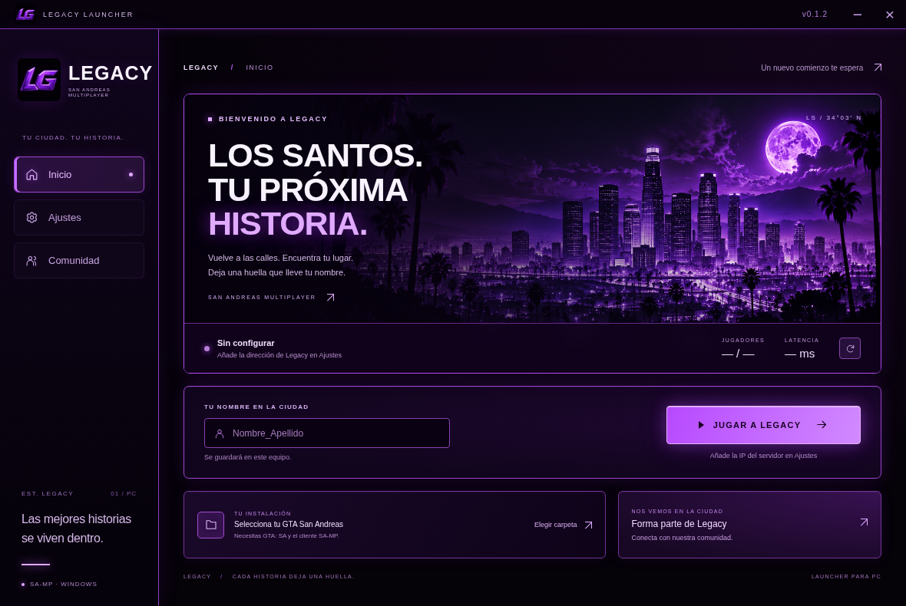

# Legacy Launcher

Launcher de escritorio en español para un servidor de SA-MP. Interfaz propia de Legacy, perfil local, selección de la instalación de GTA, consulta real del servidor y conexión mediante el cliente SA-MP instalado.

La versión 0.1.2 aplica la temática **negro y morado neón a todo el launcher**: Inicio, Ajustes, Comunidad, fondos, tarjetas, botones, campos y mensajes. Incorpora el monograma **LG** y una ciudad nocturna en violeta. El [logo en PNG](assets/logo-lg.png) se puede usar también para el servidor; los iconos de Windows y del launcher usan el mismo diseño.



Ver también: [Ajustes](docs/legacy-settings.png) · [Comunidad](docs/legacy-community.png).

La versión 0.1.3 añadió la instalación automática de CEF 1.4.1. La versión 0.1.4 incorpora la actualización del propio launcher mediante GitHub Releases.

## Usarlo en Windows

Si descargas el instalador, ejecuta `Legacy-Launcher-0.1.5-Setup.exe` y sigue los pasos. Para usar la versión ZIP:

1. Extrae **todo** el ZIP de Windows en una carpeta. No ejecutes el programa desde dentro del ZIP.
2. Abre `Legacy Launcher.exe`.
3. En **Ajustes**, selecciona la carpeta que contiene `gta_sa.exe` y `samp.exe`.
4. Introduce la IP o el dominio del servidor y su puerto (por defecto, `7777`). Puedes añadir una invitación de Discord.
5. Guarda los ajustes, vuelve a **Inicio**, escribe tu nombre y pulsa **Jugar a Legacy**.

Requiere Windows 10/11 de 64 bits, una copia propia compatible de GTA San Andreas y el cliente SA-MP correspondiente al servidor. GTA y SA-MP no se incluyen ni se descargan desde este launcher. No necesitas Node.js para usar el paquete de Windows.

**La dirección de Legacy todavía no se ha proporcionado.** Por eso el launcher empieza con el servidor sin configurar y sin estadísticas ficticias. Puedes introducir la IP desde Ajustes, sin recompilar.

El paquete no tiene firma de editor de Windows. La conexión real al juego debe comprobarse en un PC con Windows y con la dirección de Legacy configurada; las pruebas automatizadas se realizan con un servidor SA-MP de prueba local y un proceso simulado.

## Funciones

- Guarda el nombre del jugador y las preferencias en el perfil del usuario.
- Comprueba que la carpeta elegida contiene los dos ejecutables requeridos.
- Consulta el protocolo UDP de SA-MP para mostrar jugadores, capacidad y tiempo de respuesta.
- Abre `samp.exe` con la dirección del servidor y guarda el nombre en la configuración de SA-MP de Windows.
- Abre exclusivamente invitaciones HTTPS de Discord validadas.
- Diferencia entre servidor sin configurar, sin respuesta y en línea. Si el servidor tiene las consultas UDP desactivadas, puede aparecer sin respuesta aunque permita entrar a jugar.

## Desarrollo

Requiere Node.js 22.12 o posterior y npm. Desde esta carpeta:

```sh
npm ci
npm test
npm start
```

La interfaz y las consultas también pueden comprobarse en Linux o macOS; la función de jugar exige Windows. Abrir `renderer/index.html` en un navegador permite ver el diseño, pero no acceder al juego ni a los ajustes del equipo.

Las preferencias se guardan en `%APPDATA%\Legacy Launcher\settings.json` en Windows. Si el archivo está dañado, la aplicación muestra un aviso y permite guardar una configuración nueva.

## Datos para distribuir a los jugadores

Antes de compilar, edita `launcher-config.json`:

```json
{
  "name": "Legacy",
  "serverHost": "",
  "serverPort": 7777,
  "discordUrl": ""
}
```

Sustituye `serverHost` por la IP o el dominio **sin** `samp://`, `http://` ni puerto. Introduce el puerto en `serverPort`. Puedes dejar `discordUrl` vacío hasta disponer de una invitación oficial. Los datos iniciales se aplican a nuevas instalaciones; los usuarios que ya tengan preferencias conservarán sus datos guardados.

## Compilar para Windows

```sh
npm run dist:win
```

El resultado aparece en `release/Legacy-Launcher-0.1.5-Windows-x64.zip`. Incluye el ejecutable y los archivos de Electron; hay que distribuir el ZIP completo. Para generar un instalador desde Windows:

```sh
npm run dist:installer
```

El flujo `.github/workflows/build-windows.yml` compila el ZIP y el instalador en Windows y los conserva como artefactos descargables. Puedes ejecutarlo desde **Actions → Compilar Legacy Launcher para Windows → Run workflow**; también se ejecuta en pull requests y al integrar cambios en `main`. Solo las compilaciones exitosas de `main` publican una nueva versión estable en GitHub Releases.

## Actualizaciones del launcher

Instala una vez la versión 0.1.4 o posterior con el archivo Setup.exe de [Releases](https://github.com/BladimirFC/legacy-launcher/releases/latest). Al abrir el launcher se comprueba la última versión estable; si existe una nueva, puedes descargarla (con progreso y descarga diferencial cuando esté disponible) e instalarla con reinicio. Las preferencias de AppData se conservan. Desde 0.1.5 la comprobación se hace en el proceso principal al iniciar y antes de abrir SA-MP. No se muestra un panel si la versión está vigente. Si hay una actualización o no se puede verificar la versión, el launcher bloquea Jugar hasta resolverlo. La versión ZIP comprueba la versión, pero si necesita actualizarse muestra un enlace al instalador; no aplica actualizaciones en su propia carpeta. El bloqueo es local al launcher, no una restricción del servidor SA-MP.

La fuente de actualizaciones es el repositorio público oficial en HTTPS; electron-updater verifica el SHA-512 del instalador. Por ahora los ejecutables no tienen firma Authenticode y se requiere confirmación explícita antes de instalar; no existe una firma independiente del manifiesto ni garantía de rollback del instalador. Protege la cuenta de GitHub, las ramas y las publicaciones. No distribuyas tokens en la aplicación.

Para publicar una nueva versión, aumenta la versión en package.json y package-lock.json en el mismo commit, pasa las pruebas e integra en main. GitHub Actions crea primero una Release borrador con el instalador, su blockmap, ZIP y latest.yml, verifica el paquete durante el build y publica la Release completa. Una versión existente no se sobrescribe; si queda un borrador incompleto, revísalo antes de reintentar.

## Cliente CEF

Al pulsar **Jugar a Legacy**, el launcher comprueba el cliente CEF en la carpeta seleccionada. Si falta, está desactualizado o no se puede verificar, descarga la versión oficial 1.4.1 desde GitHub, comprueba el tamaño y SHA-256 del paquete y los binarios principales, e instala el cliente completo antes de abrir SA-MP. El paquete pesa unos 176 MB. Las instalaciones antiguas, incluso si están completas, se actualizan una vez. Los archivos sustituidos se conservan en una carpeta `.legacy-cef-respaldo-*` dentro de la carpeta del juego.

Cierra GTA y SA-MP antes de actualizar. El launcher verifica los archivos principales y el marcador de instalación al volver a jugar; no vuelve a descargar un cliente válido. Los otros mods no se modifican. El aporte necesita un cargador ASI para que GTA pueda ejecutar `cef.asi`. Si la descarga falla, vuelve a pulsar **Jugar a Legacy** para reintentar.

## Estructura

- `main.cjs` y `preload.cjs`: ventana de Electron y API limitada para la interfaz.
- `lib/settings.cjs`: validación y guardado de preferencias.
- `lib/samp.cjs`: consulta del servidor y apertura de SA-MP.
- `renderer/`: interfaz en HTML, CSS y JavaScript, sin servicios externos.
- `assets/`: ilustración original de la ciudad e iconos del launcher.
- `test/backend.test.cjs`: pruebas de preferencias, consultas UDP y apertura del cliente.
